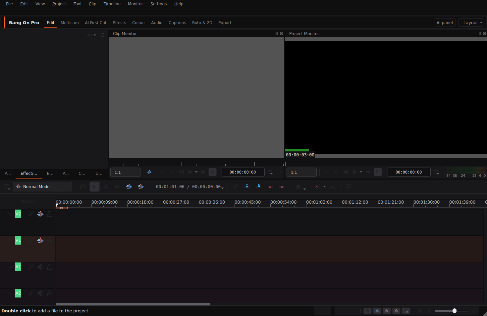
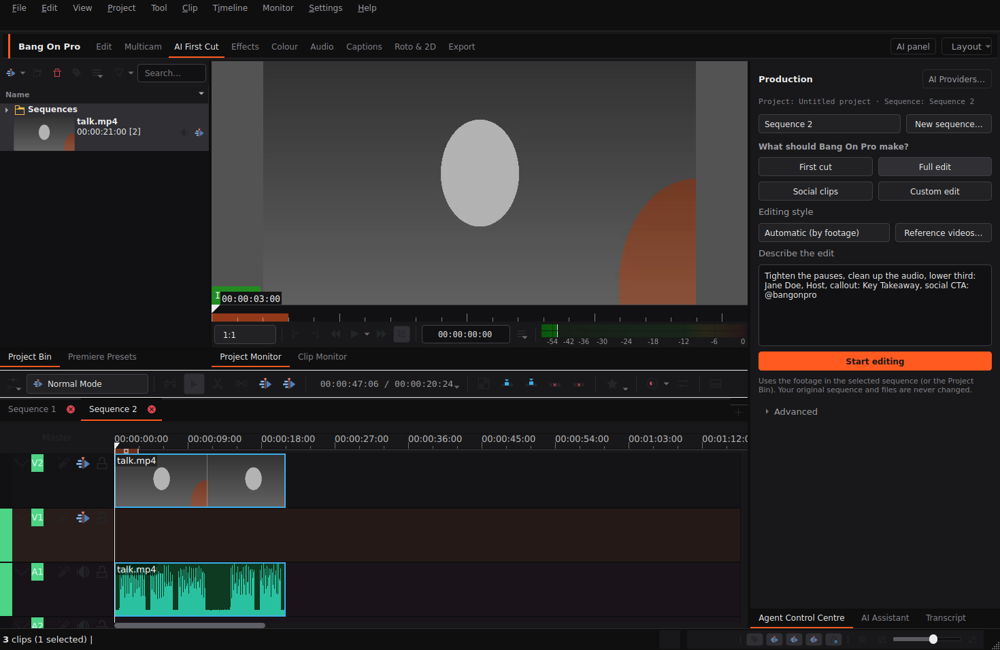
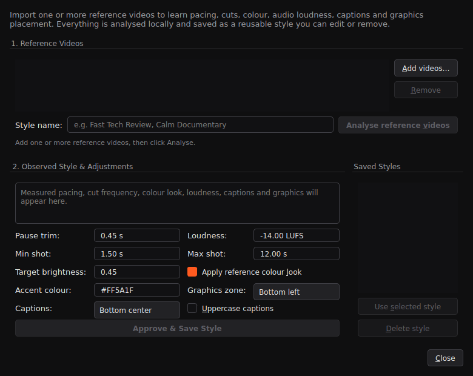
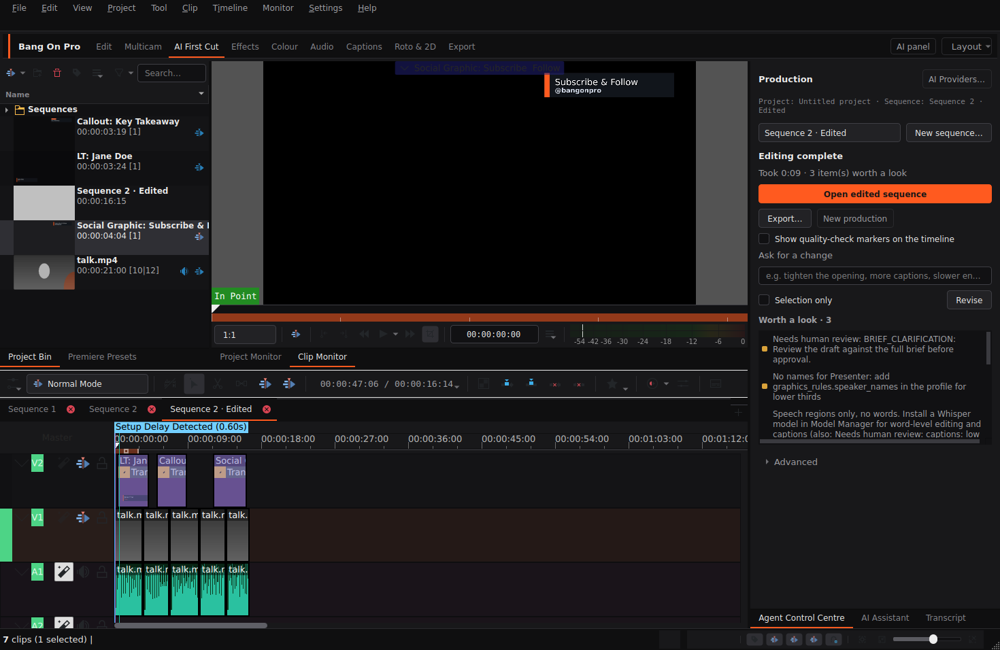
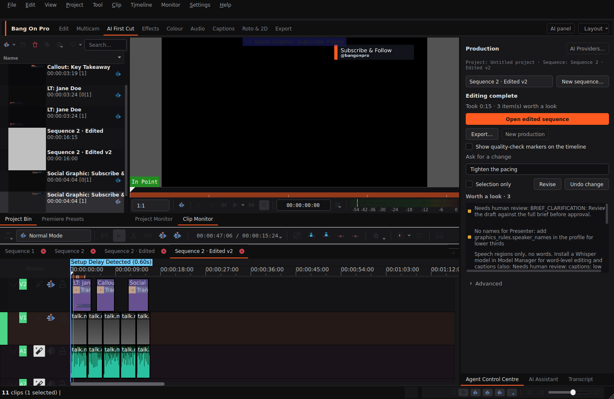

# Bang On Pro V1.6 — Editor Handbook

Welcome to **Bang On Pro V1.6**, a native non-linear video editor built for fast, repeatable studio and YouTube editing. Everything on this page happens inside the application — no terminal commands are required.

---

## 1. Installation (Apple Silicon Mac)

Bang On Pro ships as a self-contained macOS Apple Silicon (`.dmg`) installer containing the editor, media engine (MLT 7 + FFmpeg + frei0r), and bundled local AI runtime.

1. Download **`BangOnPro-1.6.0-beta.1-arm64.dmg`** (and `SHA256SUMS.txt`) from the GitHub pre-release page.
2. *(Optional integrity check)* Verify the download checksum if you wish, then double-click the `.dmg` and drag **Bang On Pro** into **Applications**.
3. **First launch:** If the build is ad-hoc signed rather than Apple-notarised (check `SIGNING_STATUS.txt` on the release), macOS Gatekeeper may ask you to confirm:
   - Control-click **Bang On Pro** in Applications → **Open** → **Open**, or
   - Open **System Settings → Privacy & Security → Open Anyway**.
4. On first launch, **System check** runs automatically to verify storage space, media tools, and local models. You can reopen it anytime from **Bang On Pro → System check…**.
   - **Local speech recognition (recommended):** Click **Model Manager…** and install **Whisper small** for word-level transcripts, captions, and filler/pause trimming. Without Whisper installed, Bang On Pro still edits using speech activity and clearly tells you that captions were withheld.

---

## 2. Workspaces & Interface Layout

Bang On Pro uses a dark, distraction-free studio layout focused on your **Monitor** and **Timeline**. Switch layouts anytime from the top workspace bar:

- **Edit** — Premiere Pro–style layout with Project Bin, Source Monitor, Program Monitor, and full-width Timeline.
- **AI First Cut** — Brings the simplified **Production** panel onto the right beside your monitor and timeline.
- **Multicam, Effects, Colour, Audio, Captions, Roto & 2D, Export** — Dedicated task workspaces. On narrower laptop displays, secondary workspace pills collapse cleanly into **More** so nothing clips.

---

## 3. Subscription Connections (Optional Reasoning)

Most editing tasks run **100% locally on your Mac** at zero cost. When you write nuanced or open-ended creative instructions that local rules do not cover, Bang On Pro can optionally consult an AI subscription you already pay for through its official desktop/CLI client — **never separately billed API keys**.

1. Click **AI Providers…** at the top right of the **Production** panel (or **Bang On Pro → AI Providers & Subscriptions…**).
2. Bang On Pro detects which official clients are installed on your Mac and shows each provider's real sign-in and eligibility status (**never mocked or guessed**).
3. Choose your preferred provider priority, set whether automatic failover is enabled, and confirm privacy consent.
4. During and after every production, the Production panel reports truthfully whether subscription reasoning was used (provider, call count, reported usage, and any failover) — or explicitly explains when the edit ran completely locally with zero subscription calls.

---

## 4. Importing Footage & Creating a Sequence

If you are familiar with Adobe Premiere Pro, this workflow will feel right at home:

1. Drag your camera clips and audio recordings into the **Project Bin** (or use **Project → Add Clip or Folder…**).
2. Select the clip(s) you want in the Project Bin.
3. Click **New sequence…** in the **Production** panel (or **Bang On Pro → New Sequence from Selected Clips…**).
4. Name your sequence and click **OK**. Your selected clips are placed onto the new sequence automatically.

> **Your original sequence is always protected.** Bang On Pro never overwrites or destroys your source footage or your original sequence. Every automated edit opens as a new sequence inside the same project.

---

## 5. Production Modes

In the **AI First Cut** workspace, choose what you want Bang On Pro to build:

| Mode | What it produces |
| --- | --- |
| **First cut** | Clean, tight assembly with balanced dialogue audio, ready for manual finishing. |
| **Full edit** | Complete edit including cut, audio cleanup, colour matching, captions, motion graphics, and quality checks. |
| **Social clips** | The full edit plus standalone vertical (9:16) social clips of the strongest moments. |
| **Custom edit** | Runs only what you request; expand **Advanced** if you want granular control over individual settings or the production queue. |

---

## 6. Editing Styles & Reference Videos

Under **Editing style**, choose **Automatic (by footage)** — which selects single-camera YouTube talking-head pacing for one camera, two-camera interview pacing for two cameras, or multicamera studio pacing for three or more — or pick any built-in or custom style.

### Learning a Style from Reference Videos

Want your edits to match the pacing, colour, loudness, and visual feel of a specific channel or series?

1. Click **Reference videos…** next to the **Editing style** dropdown (or **Bang On Pro → Reference Video Editing Styles…**).
2. Click **Add videos…** and import one or more reference videos.
3. Give your style a name (for example, *Fast Tech Review* or *Calm Documentary*) and click **Analyse reference videos**.
4. Bang On Pro analyses the reference videos locally (cached by content hash so repeat runs are instant), measuring:
   - Shot duration, pacing, and cut frequency
   - Transitions, fades, and opening structure
   - Camera framing, zooms, and B-roll cutaway share
   - Caption presence and placement
   - Graphics zones and brand accent colour
   - Colour brightness, contrast, warmth, and saturation
   - Audio loudness (LUFS), true peak, and pause cadence
5. Review the measured summary, adjust any sliders or options you prefer, and click **Approve & Save Style**.
6. Your new style is immediately added to the **Editing style** menu and can be reused, modified, or deleted anytime.

---

## 7. Writing Editing Instructions

Describe what you want in plain language inside **Describe the edit**, for example:

- *"Tighten the pauses, clean up the audio, add captions, lower third: Jane Doe, Host"*
- *"Remove dead air, keep natural conversation, callout: Key Takeaway, social CTA: @yourchannel"*
- *"Build a multicam edit switching on the active speaker with reaction shots, scoreboard: Red 3 - Blue 2"*

Bang On Pro checks every clause of your brief:
- Recognised instructions are applied directly.
- Unrecognised instructions are sent to your authorised subscription (if enabled and connected) to map onto supported actions.
- Anything that cannot be done is listed clearly under **Not done from your instructions** with a plain reason — nothing is silently ignored.

---

## 8. Monitoring Progress & Safe Recovery

Click **Start editing**. Bang On Pro walks through **eight real production stages**:

1. Analysing footage
2. Transcribing and understanding dialogue
3. Building the rough cut
4. Improving audio
5. Colour correction
6. Captions and graphics
7. Quality control
8. Preparing edited sequence

Progress bars reflect measured stage completion only. You can safely **Cancel** a running edit at any time. If the application is closed or a worker is interrupted unexpectedly, Bang On Pro detects the stopped state immediately (never freezing on "Resuming") and lets you **Resume** cleanly from the last completed checkpoint.

---

## 9. Reviewing & Revising Edited Sequences

When editing finishes, click **Open edited sequence**.

- Bang On Pro creates **`<Your Sequence> · Edited`** right inside your open project alongside your untouched original sequence.
- Picture clips sit on **V1**, dialogue on **A1**, animated graphics on **V2**, and quality-check markers stay hidden off the timeline by default (tick **Show quality-check markers on the timeline** whenever you want to inspect them).
- Everything is added in **one native Undo step** (`Cmd+Z` / `Ctrl+Z`).

### Asking for Revisions

Want a tighter pass or a different feel? Type your note under **Ask for a change** and click **Revise**:

- *"Tighten the pacing"*
- *"Keep the natural rhythm"*
- *"Use more reaction shots"* / *"Fewer camera cuts"*
- *"Add captions"* / *"Create three vertical clips"*

Tick **Selection only** to limit the revision to your active timeline In/Out zone while keeping the rest of the edit locked. When the revision finishes, click **Open edited sequence** again to open **`<Your Sequence> · Edited v2`**, **`v3`**, and so on — letting you compare versions directly in the same project, rename any sequence, or click **Undo change**.

---

## 10. Intelligent Motion Graphics

Ask for motion graphics right in your editing brief. Bang On Pro creates original, **editable native Kdenlive title clips** on V2 animated with native **Transform (`qtblend`)** keyframes — never placeholder graphics or costly video generation:

- **Titles & Lower Thirds:** `"lower third: Jane Doe, Host"` (names come from your brief or profile; internal camera IDs are never printed)
- **Scoreboards:** `"scoreboard: Red 3 - Blue 2"`
- **Statistics:** `"stat: 85% faster editing"`
- **Comparisons:** `"compare: Manual 4h vs Bang On Pro 15m"`
- **Bar Charts:** `"chart: Q1 40, Q2 65, Q3 95"`
- **Animated Captions:** `"add animated captions"` or `"animated caption: Watch this moment"`
- **Callouts:** `"callout: Key Takeaway"`
- **Branded Transitions & Social CTAs:** `"branded transition: Chapter Two"`, `"social CTA: @yourhandle"`

Every graphic is checked automatically for title-safe margins, readability contrast, and collision avoidance (including avoiding active caption zones). Double-click any graphic in the Project Bin or Timeline to edit its text, colours, or Transform keyframes directly.

---

## 11. Saving & Exporting

- **Save & Reopen:** Save your project normally (`File → Save`). All sequences (`Original`, `Edited`, `Edited v2`…), graphics, effects, and settings reopen intact.
- **Export:** Click **Export…** in the Production panel (or **Project → Render…** / switch to the **Export** workspace) to render your active edited sequence to MP4, ProRes, or any preset.

---

## 12. Troubleshooting & Diagnostics

- **System check:** Open **Bang On Pro → System check…** to verify disk space, FFmpeg/MLT, and installed local models.
- **Captions withheld:** Install a local Whisper model via **Bang On Pro → Manage Local AI Models…** and rerun.
- **Export diagnostics:** Open **Bang On Pro → Export diagnostics…** to save a privacy-safe diagnostic zip (excludes media, transcripts, and credentials by default) that you can share when reporting an issue.
